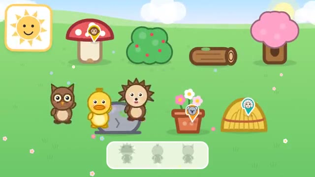

# Critter Peek

Tap the bushes to find the hiding animals. A multiplayer starter game from [Multiplayer Agent](https://multiplayeragent.com): 2D, co-op, 1–6 players, with animal buddies that help when you play alone.

## Who it is for

Little kids, ages 2 to 5, with a grown-up or a sibling on a second phone or tablet, in the same room or far away. Nobody needs to read, nobody can lose, and there is no clock. It collects nothing: no names, no chat, no scores.

## How it plays

The picture card shows which animal to find; your child taps bushes, logs and haystacks until it hops out, and after two wrong tries the right spot wiggles to help. No reading needed, and finding them all starts a parade.

A different animal giggles, waves and ducks back in (so the child learns where it is); an empty spot lets out a butterfly. Every round has new hiding places, a new mix of animals and another time of day or season. Each player's finger shows as their own animal buddy in a coloured pin, so a child sees grandma's taps.

**Controls:** Tap with one finger; the mouse works too.

## Make it yours in the Game Builder

Open the [Game Builder](https://multiplayeragent.com), choose **Start from a starter game** and pick Critter Peek. It opens as version 1 in your studio, ready to play and publish. Then ask for changes, for example:

- Make them dinosaurs hiding in a jungle
- Add a snowy winter meadow
- Hide six animals every round

## Run it yourself

1. Get a free publishable key (`pk_…`) at [multiplayeragent.com](https://multiplayeragent.com).
2. In `index.html`, put it in place of `pk_REPLACE_ME` in the `MP_CONNECT` block.
3. Open `index.html` in a browser. No build step and no server needed.

Without a key it still runs, offline with the buddies.

## How it is built

- One `index.html`. The comment at the top of the script maps the code and explains the multiplayer.
- **Bots:** Animal buddies peek slowly and leave the finding to your child.
- **Live sync:** You see each other's fingers, and every peek, at once.
- **Host-run rounds:** One player's browser keeps the round; if it leaves, the next takes over.
- Sounds are soft synthesized notes from one pentatonic scale; the 🔊 button mutes them, and animal names are spoken where the browser can (`CONFIG.speak`).
- `?attract` runs it offline with buddies only. The preview video is recorded from it.

## License

MIT.
